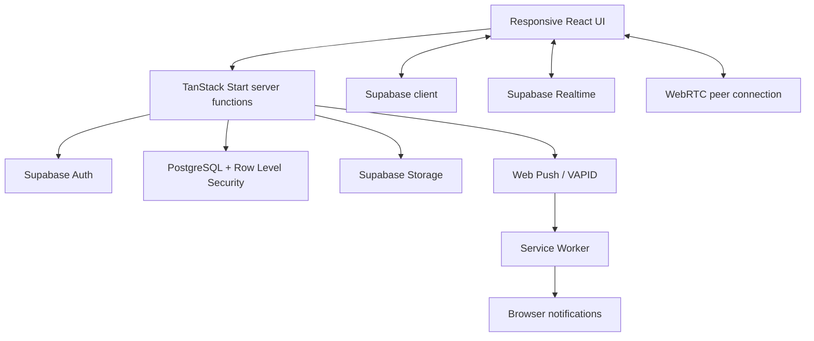

# VibeTalk

**Real-time conversations, voice notes, and calls in a responsive web app.**

VibeTalk is a full-stack messaging application built with React, TypeScript, TanStack Start, and Supabase. It brings direct messages, group rooms, live presence, voice notes, WebRTC voice/video calls, message reactions, read receipts, and browser push notifications into one interface designed for desktop and mobile screens.

> **Project status:** Portfolio / active development project. Some features depend on Supabase schema, authentication settings, push credentials, and hosting configuration. Review the setup and security notes before deploying a new instance.


## Highlights

- **Real-time messaging** — direct conversations and group rooms, with live updates and room membership controls.
- **Message actions** — emoji reactions, message editing and deletion, copy controls, and read-receipt details for your own messages.
- **Voice notes and attachments** — record and play voice messages, with server-side checks for attachment ownership and allowed MIME types.
- **Voice and video calling** — browser-based WebRTC calls, call invitations, call history, and call status handling.
- **Presence and chat status** — online/last-seen indicators, typing status, unread counts, and read receipts.
- **Push notifications** — service-worker notifications, per-device push subscriptions, test notifications, and controls for message-preview privacy.
- **Account and profile controls** — registration, sign-in, password reset/change flows, profile editing, visibility settings, and account deletion.
- **Privacy options** — private profile discovery and configurable notification previews.
- **Optional end-to-end encrypted group text** — AES-GCM message encryption with per-recipient wrapped message keys for group rooms created with E2EE enabled.
- **Responsive interface** — dedicated mobile and desktop layouts, with profile, people, rooms, and calls views.
- **Deployment safeguards** — separate Cloudflare and Vercel build targets, parity checks for configuration and security headers, and scripts intended to prevent stale or mismatched deployment artifacts.

## Screenshots

The repository currently includes a social-preview graphic at [`public/og-image.png`](public/og-image.png). Add real, current screenshots or a short product GIF here before sharing the repository with recruiters or clients; a social-preview banner is not a substitute for screenshots of the working product.

## Technology stack

| Area | Technologies |
| --- | --- |
| UI | React 19, TypeScript, Tailwind CSS 4, Radix UI, Lucide |
| Application framework | TanStack Start, TanStack Router, TanStack React Query, Vite |
| Backend and data | Supabase Auth, PostgreSQL, Row Level Security, Supabase Realtime, Storage |
| Real-time calls | WebRTC, with STUN/TURN configuration |
| Notifications | Service Worker, Web Push, VAPID |
| Validation and forms | Zod, React Hook Form |
| Hosting targets | Cloudflare Workers and Vercel |
| Code quality | TypeScript checks, ESLint, Prettier, build/configuration guard scripts |

## Architecture at a glance



- **Client:** React routes and reusable components handle the responsive experience, realtime subscriptions, media capture, and browser APIs.
- **Server:** TanStack Start server functions perform authenticated operations and keep privileged service-role access on the server.
- **Data access:** Supabase provides authentication, relational data, storage, and realtime events. Database policies are an important part of the authorization boundary.
- **Calls:** WebRTC handles the peer connection; signaling and call state are coordinated through the app and Supabase-backed functions/channels.
- **Notifications:** The service worker handles background notification behavior while server-side Web Push uses VAPID credentials.

## Getting started

### Prerequisites

- Node.js 22 or a compatible supported Node.js release
- npm
- A Supabase project with the required schema, policies, storage configuration, and authentication settings
- Optional: VAPID keys for background push notifications
- Optional: a restricted, rate-limited TURN credential for more reliable calls across restrictive networks

### 1. Install dependencies

```bash
git clone <your-repository-url>
cd <repository-directory>
npm ci
```

Use the repository URL and directory name for your own GitHub repository. Do not commit `node_modules` or generated deployment output.

### 2. Configure environment variables

Copy the example file and fill in values for your own development environment:

```bash
cp .env.example .env
```

Configure the variables documented in `.env.example`:

| Variable | Purpose |
| --- | --- |
| `SUPABASE_URL` | Supabase project URL used by server-side code |
| `SUPABASE_PUBLISHABLE_KEY` | Public/publishable key used by server-side Supabase client setup |
| `VITE_SUPABASE_URL` | Supabase URL compiled into the browser bundle; must match `SUPABASE_URL` |
| `VITE_SUPABASE_PUBLISHABLE_KEY` | Browser-facing publishable key |
| `VITE_SUPABASE_PROJECT_ID` | Project identifier used by client configuration |
| `VAPID_PUBLIC_KEY` | Public VAPID key for Web Push setup |
| `VITE_VAPID_PUBLIC_KEY` | Browser build-time VAPID public key; keep it paired with the server key |
| `VAPID_SUBJECT` | Optional VAPID contact URL for push messages |
| `VITE_TURN_URLS` | Optional STUN/TURN server URL(s) for WebRTC |
| `VITE_TURN_USERNAME` | Optional TURN username |
| `VITE_TURN_CREDENTIAL` | Optional TURN credential; anything prefixed with `VITE_` is exposed in the client bundle |

**Never put privileged credentials in `.env.example`, source control, screenshots, issue reports, or client-side variables.** `SUPABASE_SERVICE_ROLE_KEY` and `VAPID_PRIVATE_KEY` must be configured as server-side secrets in the hosting provider's dashboard/secret store, not as `VITE_` variables. Treat TURN credentials as public if they are embedded in a `VITE_` variable; use restricted or short-lived credentials.

The server-side and browser-side Supabase URLs/project configuration must refer to the same project. A mismatch can cause authentication failures that look like session bugs.

### 3. Set up Supabase

1. Create or select a Supabase project.
2. Review the SQL in `supabase/migrations/` and apply the migrations in order using your normal Supabase migration workflow.
3. Review the additional `supabase/vibetalk-*.sql` files carefully before applying them. The repository contains audit/fix scripts and consolidated SQL snapshots; **do not blindly execute every SQL file**, because some overlap or represent alternate application paths.
4. Confirm Row Level Security policies protect profiles, rooms, memberships, messages, reactions, calls, and other user-scoped records.
5. Configure Supabase Auth site/redirect URLs for your own development and production domains, along with the required email/password settings.
6. Configure the required server secrets in the hosting provider before enabling features that need privileged database access or push delivery.

The repository's `AGENTS.md` records additional deployment and Supabase dashboard assumptions. Read it before deploying or changing security-sensitive configuration.

### 4. Run locally

```bash
npm run dev
```

Use the local URL printed by Vite. For a production-style build and preview:

```bash
npm run build
npm run preview
```

## Development commands

| Command | Description |
| --- | --- |
| `npm run dev` | Start the Vite development server |
| `npm run typecheck` | Run the TypeScript compiler without emitting files |
| `npm run lint` | Run ESLint on source, scripts, Vite configs, and the service worker |
| `npm run build` | Type-check, verify config/header parity, and build the Cloudflare-targeted output |
| `npm run build:vercel` | Build the Vercel target after cleaning stale output and running guard checks |
| `npm run deploy:build` | Run both production build paths and their guard checks |
| `npm run build:dev` | Create a development build in a separate, explicitly non-deployable output directory |
| `npm run check:vite-parity` | Check that the Cloudflare and Vercel Vite configurations stay aligned |
| `npm run check:security-headers-parity` | Check security-header parity across hosting configurations |
| `npm run format` | Format files with Prettier |

Run `npm run typecheck`, `npm run lint`, and the relevant production build before submitting changes. The deployment scripts are deliberately opinionated; read `AGENTS.md` before using host-specific deployment commands.

## Deployment

VibeTalk includes build configuration for **Cloudflare Workers** and **Vercel**. Both targets use the same application configuration preset, with the hosting target differing by build configuration. The repository includes scripts that compare configuration and security headers and help avoid deploying stale output.

Before deploying:

1. Configure all required environment variables and server-side secrets in the target host.
2. Confirm Supabase Auth redirect URLs and the browser/server Supabase project configuration match the deployment.
3. Read `AGENTS.md` and use the prescribed build/deploy sequence for the chosen host.
4. Verify the deployed app, service worker, authentication, realtime messaging, calls, and push notifications after deployment.
5. Never deploy a development build or stale output directory.

Exact hosting dashboards, domains, secret names, and deployment commands can vary by account. Do not copy production credentials from another environment into a new deployment.

## Security and privacy notes

- Authorization must be enforced on the server and in Supabase Row Level Security policies; client-side checks are not security boundaries.
- Privileged service-role credentials and VAPID private keys must remain server-side.
- Public build-time variables (`VITE_*`) are visible to users in the compiled browser bundle.
- The optional E2EE implementation applies to **text messages in newly created group rooms where E2EE is enabled**. It does **not** currently encrypt attachments or voice messages using that E2EE layer. Do not describe the entire application or every message type as end-to-end encrypted.
- WebRTC call security and the app's text-message E2EE are separate concerns; review the call/signaling threat model before making security claims about calls.
- Review the SQL migration history and `AGENTS.md` threat-model notes before production use.

This README describes the implementation present in the repository; it is not a security audit or a guarantee that a deployment is correctly configured.

## Repository structure

```text
.
├── public/                  # Static assets, service worker, Android APK, social preview
├── scripts/                 # Build, deployment, and parity guard scripts
├── src/
│   ├── components/          # Chat UI, call overlay, voice notes, profile and mobile UI
│   ├── hooks/               # Shared React hooks
│   ├── integrations/supabase/# Supabase clients, auth middleware and generated types
│   ├── lib/                 # Chat/auth server functions, calls, E2EE, push, uploads, security helpers
│   ├── routes/              # Landing, auth, rooms, people, calls and profile routes
│   ├── server.ts            # Server entry and error handling
│   └── router.tsx           # Router setup
├── supabase/
│   ├── migrations/          # Ordered database migrations
│   └── vibetalk-*.sql       # Additional SQL scripts and consolidated snapshots
├── AGENTS.md                # Architecture, security and deployment rules
├── .env.example             # Environment-variable template (no secret values)
├── package.json             # Scripts and dependencies
├── vite.config.ts           # Cloudflare-targeted Vite configuration
└── vite.config.vercel.ts    # Vercel-targeted Vite configuration
```

## Known limitations and deployment considerations

- Push notifications require correct VAPID configuration, a working service worker, browser permission, and host-side secrets.
- Calls may require valid STUN/TURN configuration for users behind restrictive NATs or firewalls.
- The TURN configuration currently supports client-provided values; do not embed privileged or long-lived TURN credentials in the client bundle.
- E2EE coverage is limited as described above; attachments and voice notes are outside that text-encryption layer.
- This repository does not include an automated test suite in `package.json`; type-checking, linting, and build guard scripts are available. Add unit/integration/e2e tests before presenting it as production-hardened.
- Confirm license and contribution terms before accepting external contributions or presenting the project as open source. No root `LICENSE` file was present in the reviewed project archive.

## Roadmap ideas

- Add automated tests for authorization boundaries, messaging, E2EE envelope handling, push delivery, and call lifecycle edge cases.
- Add browser-based end-to-end tests for sign-up, direct/group messaging, attachments, notifications, and calling.
- Add short, current screenshots and an accessible product demo walkthrough.
- Consider ephemeral, server-minted TURN credentials and review key lifecycle/multi-device recovery for E2EE.
- Document a repeatable clean-environment database bootstrap and deployment verification checklist.

## Contributing

Contributions are welcome once the project owner has published contribution and licensing terms. For a change, please:

1. Open an issue describing the problem or proposed behavior.
2. Keep authorization checks on the server and in database policies where appropriate.
3. Run `npm run typecheck`, `npm run lint`, and the relevant build checks.
4. Include tests or reproducible verification steps for behavior changes.
5. Avoid committing `.env`, secrets, local Wrangler state, generated output, or personal data.

## License

No license file was included in the reviewed archive. Until a license is added by the project owner, all rights remain with the copyright holder and reuse permissions should not be assumed.

## Acknowledgements

Built with React, TypeScript, TanStack, Supabase, Tailwind CSS, Radix UI, and the wider open-source ecosystem.
